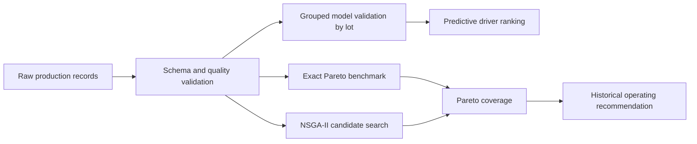

# Pharmaceutical Tablet Production Optimization
A pharmaceutical company was experiencing problems with the manufacturing of its tablets; their friability was too high.

**Leakage-aware machine learning and validated NSGA-II multi-objective optimization for tablet manufacturing.**

This repository documents my contribution to a pharmaceutical-production project and turns the complete work into a reproducible portfolio case study.

## Business Problem

Tablet manufacturing showed meaningful batch-to-batch variation in friability, a quality indicator associated with abrasion, breakage, material loss, and potential rework. Without a quantitative view of the process, it was difficult to know which measurements were most informative or how to reduce friability without applying unnecessary compression force, leading to a major punch fatigue and tip fracturing.

Operationally, uncontrolled variability can slow production, increase waste, and make demand planning less reliable. The project therefore addressed two business questions:

1. **Which production variables are most strongly associated with friability?**
2. **Which observed operating profiles offer the best balance between tablet quality and compression demand?**

## Project Scheme

| Project phase |  Contributions |
|---|---|
| Problem framing and domain research | Define the production-quality problem and connected it with pharmaceutical evidence |
| Data preparation and exploration | Data review, cleaning, descriptive analysis, and identification of relevant variable relationships |
| Predictive modeling | Model comparison, evaluation, and interpretation of the variables associated with friability |
| Multi-objective optimization | Implemented a genetic-algorithm analysis used to search for the best quality-pressure trade-offs |
| Final stage | Done operational conclusions and final presentation |

The genetic algorithm identified the minimum-friability, low-compression regime; the exact Pareto benchmark in this portfolio version verifies that conclusion and refines the best observed point to **0.25% friability at 24.55 kN**.

## Technical Scope

The project combines predictive analysis and optimization to answer different but complementary questions:

| Component | Decision supported |
|---|---|
| Leakage-aware machine learning | Identify the measurements with the strongest predictive value on unseen production lots |
| Exact Pareto analysis | Establish the mathematically nondominated historical trade-offs |
| NSGA-II genetic optimization | Search for quality-pressure solutions using evolutionary selection, crossover, and mutation |
| Exact benchmark validation | Verify whether the genetic algorithm actually recovers the true historical Pareto front |

Rather than stopping at defect prediction, this repository converts the analysis into a decision-oriented optimization problem: **minimize friability and compression force simultaneously while remaining within observed production profiles**.

## Executive Result

| Result | Value |
|---|---:|
| Production records | 1,098 |
| Production lots | 60 |
| Exact nondominated trade-offs | 5 |
| NSGA-II Pareto coverage | **100%** |
| Best observed friability | **0.25%** |
| Compression at that quality level | **24.55 kN** |
| Lot-grouped validation R² | **0.443** |

The genetic search first identified the correct decision region: the minimum observed friability attainable with relatively low compression. Exact enumeration then verified the historical Pareto front and refined the same-quality candidate from `25.76 kN` to `24.55 kN`, a 4.7% reduction. The selected profile is a candidate for controlled confirmation—not a causal or production-ready prescription.

## Scientific Foundation and Primary Acknowledgment

The pharmaceutical interpretation of the genetic results is grounded primarily in the work of **Julieta Villar Alvez**, whose experimental study provided the domain framework for understanding how compression pressure, hardness, friability, humidity, formulation, and compression time interact in tablet quality.

> We gratefully acknowledge **Julieta Villar Alvez** for *Factores que afectan a la compresión de comprimidos* (2017). Her work at the Universidad de Sevilla was the principal pharmaceutical reference used to comprehend and justify the quality-pressure trade-off behind this project.

The genetic algorithm's quality-pressure conclusion is mathematically verified by the exact Pareto analysis and pharmacotechnically supported by Villar Alvez's experimental work. The specific numerical result at `24.55 kN` comes from this project's dataset and optimization analysis.

- [Official record in idUS](https://idus.us.es/items/de5f0215-310f-4c95-b62e-fef0714b5a69)
- [Full document](https://idus.us.es/server/api/core/bitstreams/ff0722b4-1a38-47be-829d-ffdb4f5796d7/content)

## Method

### 1. Data validation

The processed dataset contains 1,098 observations from 60 production lots with no missing values. Friability is constant within each lot, so random row splitting leaks lot-level information between training and test sets.

### 2. Predictive analysis

An Extra Trees model is evaluated with five-fold `GroupKFold`, using production lot as the group. Held-out-lot permutation importance identifies **compression, hardness, and minimum weight** as the strongest predictive signals.

### 3. Multi-objective optimization

Each historical production profile is evaluated on two minimization objectives:

$$
f_1(x)=\text{friability percentage}, \qquad
f_2(x)=\text{mean compression force in kN}
$$

The exact front provides ground truth, the NSGA-II implementation recovers all five nondominated objective pairs across three fixed seeds.

## Limitations

- The dataset is observational; importance does not establish causality.
- Friability is a lot-level measurement repeated across process records.
- Two compression observations fall below the IQR lower fence; the `0.62 kN` Pareto point requires experimental verification.
- The optimizer ranks historical profiles and does not yet generate validated continuous machine setpoints.
- Raw data is excluded because of an NDA.
